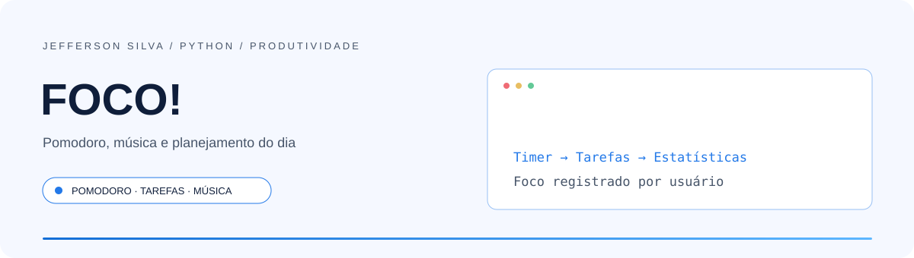
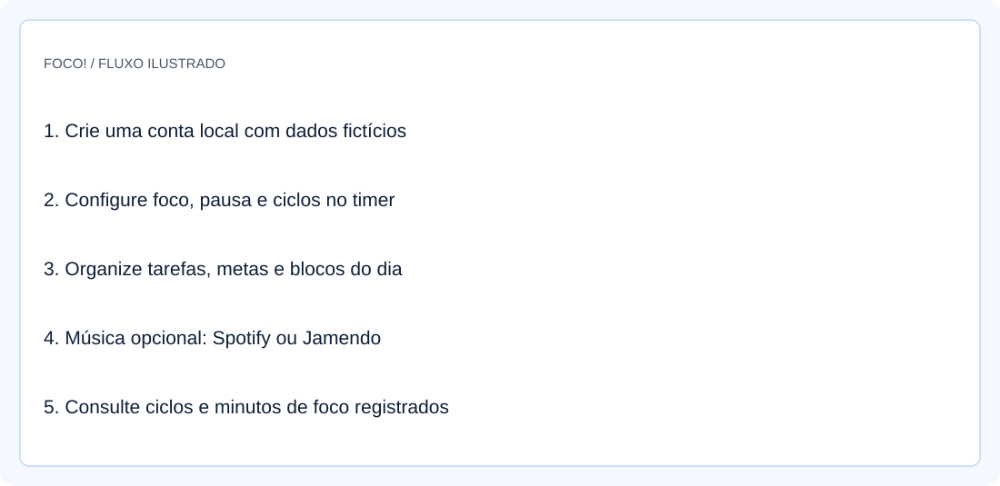
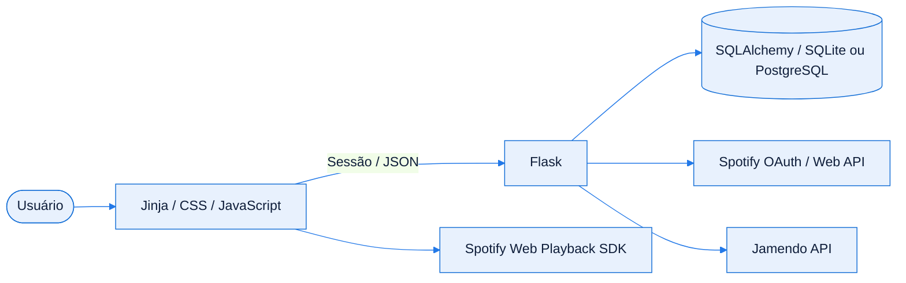
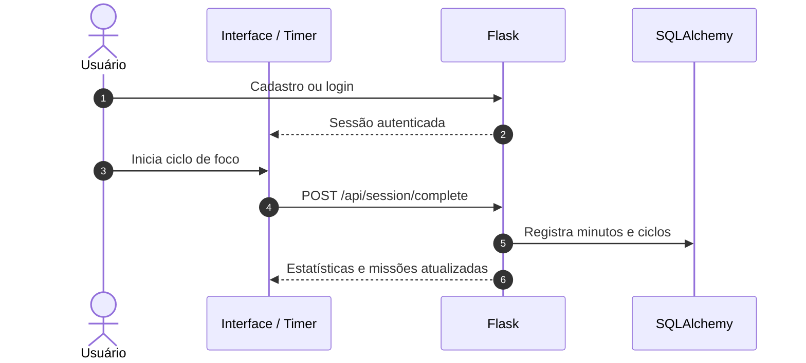
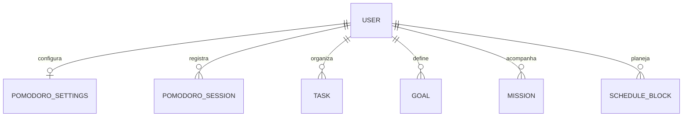

<!-- Jefferson Silva / README 4.0 — adaptado ao código de FOCO!. -->

<div align="center">

<picture>
  <source media="(prefers-color-scheme: dark)" srcset="./assets/banner-dark.svg" />
  <source media="(prefers-color-scheme: light)" srcset="./assets/banner-light.svg" />
  
</picture>

<br />
<br />

**Pomodoro, tarefas e planejamento com integração Spotify e Jamendo.**

<p>
  <a href="#inicio-rapido"></a>
  <a href="https://github.com/jeffsilva03/pomodoro-spotify/issues/new"></a>
</p>

[](https://github.com/jeffsilva03/pomodoro-spotify/commits/)
[](https://github.com/jeffsilva03/pomodoro-spotify)
[](https://github.com/jeffsilva03/pomodoro-spotify)
[](https://github.com/jeffsilva03/pomodoro-spotify/issues)
[](https://github.com/jeffsilva03/pomodoro-spotify/stargazers)

<a href="#stack">
  <picture>
    <source media="(prefers-color-scheme: dark)" srcset="https://skillicons.dev/icons?i=python,flask,js,html,css&theme=dark" />
    
  </picture>
</a>

<br />
<br />

<a href="#visao-geral">Visão geral</a> &nbsp;•&nbsp;
<a href="#demonstracao">Demonstração</a> &nbsp;•&nbsp;
<a href="#funcionalidades">Funcionalidades</a> &nbsp;•&nbsp;
<a href="#stack">Stack</a> &nbsp;•&nbsp;
<a href="#arquitetura">Arquitetura</a> &nbsp;•&nbsp;
<a href="#inicio-rapido">Instalação</a> &nbsp;•&nbsp;
<a href="#exemplos">Exemplos</a> &nbsp;•&nbsp;
<a href="#roadmap">Roadmap</a> &nbsp;•&nbsp;
<a href="#contribuir">Contribuir</a>

</div>

<br />

> [!NOTE]
> **Status:** Aplicação implementada, com 11 verificações locais de conta, tarefas e foco. Integrações musicais exigem credenciais e não foram exercitadas nesta revisão.

<a id="visao-geral"></a>
## ✦ Visão geral

**FOCO!** combina timer Pomodoro, tarefas, metas, missões e blocos de agenda com reprodução musical opcional. O backend Flask usa SQLAlchemy para guardar dados por usuário; o frontend JavaScript controla o timer e os players Spotify e Jamendo. O timer e as tarefas podem ser usados sem configurar música.

<table>
<tr>
<td width="33%" valign="top">

**🧩 Problema**

Alternar entre cronômetro, tarefas, planejamento e música fragmenta uma sessão de estudo.

</td>
<td width="33%" valign="top">

**🛠️ Solução**

Reúne ciclos de foco/pausa, lista de tarefas e acompanhamento de produtividade em uma interface.

</td>
<td width="33%" valign="top">

**📈 Resultado**

Registra minutos e ciclos por usuário e oferece metas, missões, agenda e integrações musicais configuráveis.

</td>
</tr>
</table>

<a id="demonstracao"></a>
## ◐ Demonstração

<div align="center">

<picture>
  <source media="(prefers-color-scheme: dark)" srcset="./assets/screenshot-dark.svg" />
  
</picture>

<sub>Ilustração do fluxo. Cadastro, tarefas e registro de foco verificados localmente; reprodução externa não testada.</sub>

</div>

<details>
<summary><b>▶ Ver o fluxo em ação</b></summary>

Siga o [Início rápido](#inicio-rapido) e os [Exemplos de uso](#exemplos). As ilustrações não são capturas de contas ou bancos pessoais.

</details>

<a id="funcionalidades"></a>
## ◈ Funcionalidades

<sub>✅ Implementado &nbsp; 🚧 Parcial &nbsp; 🗓️ Planejado</sub>

| Módulo | O que faz | Estado |
| :-- | :-- | :-- |
| **Pomodoro** | Configura foco, pausa, ciclos e comportamento da música | ✅ |
| **Tarefas e agenda** | Tarefas diárias/semanais/mensais, blocos de horário e modelos de rotina | ✅ |
| **Produtividade** | Estatísticas, minutos por horário, metas e missões | ✅ |
| **Conta** | Cadastro, login e dados vinculados ao usuário | ✅ |
| **Spotify** | OAuth, renovação de tokens, busca, playlists e Web Playback SDK | ✅ |
| **Jamendo** | Busca e playlists por API como player alternativo | ✅ |
| **Integrações em produção** | Exigem credenciais próprias; reprodução não foi validada nesta revisão | 🚧 |

<details>
<summary><b>▶ Regras de negócio e validações</b></summary>

| Regra | Comportamento |
| :-- | :-- |
| Cadastro | Exige e-mail e senha de ao menos seis caracteres; grava hash bcrypt |
| Tarefas | Título obrigatório; valores inválidos de categoria/período recebem padrões |
| Isolamento | Tarefas são consultadas e alteradas pelo ID e pelo usuário autenticado |
| Configuração | Backend converte foco, pausa e ciclos para inteiros; não aplica validação completa de intervalo |
| Estatísticas | Usam registros enviados pelo cliente; não são prova de tempo efetivamente estudado |
| Spotify | Tokens ficam no banco; segredo do aplicativo vem do ambiente |

</details>

<a id="stack"></a>
## ⚙ Stack e decisões técnicas

| Camada | Tecnologia | Por que foi escolhida |
| :-- | :-- | :-- |
| Backend | Python / Flask 3.0.3 | Páginas, sessões e endpoints JSON |
| Dados | Flask-SQLAlchemy / SQLite / psycopg | SQLite local e suporte a PostgreSQL por URL |
| Autenticação | Flask-Login / Flask-Bcrypt | Sessão autenticada e hash de senha |
| Interface | Jinja / HTML / CSS / JavaScript | Renderização das telas e controle do timer no navegador |
| Música | Spotify Web Playback SDK / Jamendo / requests | OAuth, consulta de catálogo e reprodução |
| Configuração | python-dotenv / Gunicorn | Carregamento local de ambiente e processo de hospedagem |

> [!TIP]
> `requirements.txt` contém versões fixas e intervalos. O banco é criado por `db.create_all()` ao importar a aplicação; não há migrations versionadas.

<a id="arquitetura"></a>
## ⬡ Arquitetura



<details>
<summary><b>▶ Responsabilidade de cada componente</b></summary>

| Componente | Responsabilidade |
| :-- | :-- |
| `app.py` | Modelos, autenticação, produtividade e proxies das APIs musicais |
| `templates/` | Login, cadastro e interface principal |
| `static/js/app.js` | Timer, navegação, tarefas, agenda, gráficos e players |
| `static/css/main.css` | Estilos da aplicação |
| `.env.example` | Nomes e valores ilustrativos das configurações |

</details>

<details>
<summary><b>▶ Fluxo principal passo a passo</b></summary>



</details>

<details>
<summary><b>▶ Modelo de dados</b></summary>



O código também inclui `HourlySession` e `ScheduleTemplate`. Tokens Spotify são campos do usuário, sem cifra adicional implementada na aplicação.

</details>

<a id="inicio-rapido"></a>
## ⚡ Início rápido

**Pré-requisitos**

| Ferramenta | Versão | Como verificar |
| :-- | :-- | :-- |
| Python | 3.14.3 usado na revisão | `python --version` |
| pip | No ambiente virtual | `python -m pip --version` |
| Spotify | Opcional; Web Playback SDK exige Premium | [Documentação oficial](https://developer.spotify.com/documentation/web-playback-sdk/tutorials/getting-started) |

<details open>
<summary><b>Windows · PowerShell</b></summary>

```powershell
git clone https://github.com/jeffsilva03/pomodoro-spotify.git
cd pomodoro-spotify
python -m venv .venv
.\.venv\Scripts\python.exe -m pip install -r requirements.txt
Copy-Item .env.example .env
# Gere SECRET_KEY e preencha o .env; música é opcional.
.\.venv\Scripts\python.exe app.py
```

</details>

<details>
<summary><b>▶ Linux / macOS</b></summary>

```bash
git clone https://github.com/jeffsilva03/pomodoro-spotify.git
cd pomodoro-spotify
python3 -m venv .venv
.venv/bin/python -m pip install -r requirements.txt
cp .env.example .env
# Configure SECRET_KEY antes de iniciar.
.venv/bin/python app.py
```

Sequência documentada; não executada neste ambiente.

</details>

> [!TIP]
> Abra **http://127.0.0.1:5000**, crie uma conta fictícia e teste o timer sem conectar serviços externos. SQLite fica em `instance/pomodoro.db`, ignorado pelo Git.

**Variáveis de ambiente**

| Variável | Obrigatória | Padrão | Descrição |
| :-- | :-- | :-- | :-- |
| `SECRET_KEY` | Configure | Fallback de desenvolvimento | Assina as sessões; gere valor aleatório para cada instalação |
| `DATABASE_URL` | — | `sqlite:///pomodoro.db` | SQLite ou URL PostgreSQL |
| `SPOTIFY_CLIENT_ID` / `SPOTIFY_CLIENT_SECRET` | Spotify | Vazias no código | Credenciais do aplicativo no Spotify |
| `SPOTIFY_REDIRECT_URI` | Spotify | `127.0.0.1` no exemplo | Deve coincidir com o callback cadastrado no provedor |
| `JAMENDO_CLIENT_ID` | Jamendo | Vazia | Identificação do aplicativo Jamendo |
| `APP_TIMEZONE` | — | `America/Sao_Paulo` | Fuso de calendário e estatísticas |

Para Spotify local, cadastre **http://127.0.0.1:5000/callback** e use esse mesmo host ao acessar o app. O provedor exige IP explícito para loopback e não aceita `localhost` como redirect URI: [regras oficiais](https://developer.spotify.com/documentation/web-api/concepts/redirect_uri).

> [!IMPORTANT]
> `python app.py` habilita debug e é destinado ao uso local. A hospedagem exige segredo próprio, HTTPS, controle dos dados e um processo adequado; o guia existente está em [DEPLOY.md](./DEPLOY.md). Preços e disponibilidade dos serviços não foram verificados.

<details>
<summary><b>▶ Problemas comuns</b></summary>

| Sintoma | Causa provável | Como resolver |
| :-- | :-- | :-- |
| Spotify retorna erro no callback | URI/host diferentes | Use o mesmo `127.0.0.1` no app, ambiente e painel do provedor |
| Player Spotify não toca | Conta, permissões ou restrições do navegador | Confira os requisitos do SDK e interaja com o player |
| Jamendo sem músicas | Client ID ausente ou falha externa | Configure seu identificador e confira a resposta da API |
| Dados não aparecem | Banco/usuário diferentes | Confira `DATABASE_URL` e o login usado |

</details>

<a id="exemplos"></a>
## ◉ Exemplos de uso

<details open>
<summary><b>▶ Cenário principal</b></summary>

1. Cadastre uma conta local com e-mail fictício.
2. Configure foco de 25 minutos, pausa de 5 e quatro ciclos.
3. Crie uma tarefa em **Tarefas**, inicie o timer e consulte **Estatísticas**.
4. Configure as credenciais musicais somente se quiser testar os players.

O fluxo de tarefas e o registro de foco foram conferidos com SQLite temporário, sem contas Spotify/Jamendo reais.

</details>

<details>
<summary><b>▶ Endpoints da API</b></summary>

| Método | Rota | Descrição | Autenticação |
| :-- | :-- | :-- | :-- |
| `POST` | `/api/settings` | Atualiza configurações do timer | Sessão |
| `POST` | `/api/session/complete` | Registra foco/ciclos enviados pelo cliente | Sessão |
| `GET` | `/api/stats` | Resumo de produtividade | Sessão |
| `GET`, `POST` | `/api/tasks` | Lista e cria tarefas | Sessão |
| `PATCH`, `DELETE` | `/api/tasks/{id}` | Atualiza ou remove tarefa do usuário | Sessão |
| `GET`, `POST` | `/api/schedule` | Agenda por blocos de horário | Sessão |
| `GET` | `/api/spotify/token` | Obtém token Spotify válido | Sessão |

Exemplo de corpo para criar uma tarefa em uma sessão autenticada:

```json
{"title":"Revisar um capítulo","category":"estudo","period":"daily"}
```

</details>

<details>
<summary><b>▶ Testes e qualidade</b></summary>

| Comando / verificação | O que faz |
| :-- | :-- |
| `python -m compileall -q app.py` | Confere sintaxe Python |
| `node --check static/js/app.js` | Confere sintaxe do JavaScript |
| Verificação local com Flask test client | 11 cenários de conta, tarefas, foco e isolamento por usuário |

Não há suíte automatizada versionada. Os resultados desta revisão e seus limites estão em [Validação da documentação](./docs/validacao-readme.md).

</details>

<a id="roadmap"></a>
## ◇ Roadmap

- [x] Implementar timer, tarefas, agenda e indicadores
- [x] Integrar Spotify e Jamendo de forma configurável
- [x] Documentar ambiente e proteger arquivos locais no Git
- [ ] Adicionar testes automatizados e migrations
- [ ] Reforçar segurança de sessão, CSRF e armazenamento de tokens
- [ ] Validar OAuth e reprodução com contas autorizadas

<sub>Os itens pendentes são sugestões de evolução, sem prazo definido. Acompanhe e sugira melhorias nas <a href="https://github.com/jeffsilva03/pomodoro-spotify/issues">issues</a>.</sub>

<a id="documentacao"></a>
## ▤ Documentação

<details>
<summary><b>▶ Estrutura de pastas</b></summary>

```text
pomodoro-spotify/
├── app.py
├── templates/                 # páginas Jinja
├── static/
│   ├── css/main.css
│   └── js/app.js
├── assets/                    # documentação nos dois temas
├── docs/                      # auditoria e validação
├── .env.example
├── requirements.txt
├── DEPLOY.md
└── README.md
```

</details>

<details>
<summary><b>▶ Perguntas frequentes</b></summary>

**Preciso conectar Spotify para usar o timer?**
Não. O cadastro, o timer e as tarefas funcionam sem configuração musical.

**Há banco ou tokens reais no repositório?**
Não foram encontrados no conteúdo e histórico disponíveis nesta revisão. O banco local e `.env` são ignorados.

**Existe licença de uso?**
Não há arquivo de licença no repositório; nenhuma licença foi presumida.

</details>

<details>
<summary><b>▶ Limitações e segurança</b></summary>

- **Limitações:** credenciais e disponibilidade dos provedores condicionam a música; sincronização real de áudio não foi testada.
- **Segurança:** há segredo padrão de desenvolvimento e debug na execução direta; não foi identificada proteção CSRF explícita. Tokens Spotify ficam no banco.
- **Auditoria:** veja [dados, arquivos e histórico](./docs/auditoria-portfolio.md). Não foram consultadas contas externas.
- **Reportar vulnerabilidade:** combine um canal reservado com o autor antes de compartilhar credenciais ou dados.

</details>

<a id="contribuir"></a>
## ⇄ Contribuir

1. Faça um fork e crie uma branch: `git checkout -b feat/minha-melhoria`
2. Faça commits seguindo o padrão abaixo
3. Rode `python -m compileall -q app.py`, confira os fluxos alterados e execute os testes disponíveis antes de abrir o PR
4. Abra um Pull Request descrevendo o que mudou e por quê

<details>
<summary><b>▶ Padrão de commits</b></summary>

| Prefixo | Quando usar | Exemplo |
| :-- | :-- | :-- |
| `feat` | Nova funcionalidade | `feat: adiciona filtro por data` |
| `fix` | Correção de bug | `fix: corrige cálculo do total` |
| `docs` | Só documentação | `docs: atualiza instalação` |
| `refactor` | Mudança interna sem alterar comportamento | `refactor: separa serviço de e-mail` |
| `test` | Testes | `test: cobre fluxo de login` |
| `chore` | Configuração e manutenção | `chore: atualiza dependências` |

</details>

## ◎ Autor

<table>
<tr>
<td align="center" width="140">
  <a href="https://github.com/jeffsilva03"></a>
</td>
<td>

**Jefferson Silva**<br />
Portfólio · FOCO!<br />
Aplicação Flask de produtividade e integração musical.

<a href="https://github.com/jeffsilva03"></a>

</td>
</tr>
</table>

---

<div align="center">

Se este projeto foi útil, considere deixar uma ⭐ — isso ajuda outras pessoas a encontrá-lo.

<br />

<a href="#visao-geral"></a>

<sub>Python &nbsp;•&nbsp; Flask &nbsp;•&nbsp; Spotify</sub>

</div>
